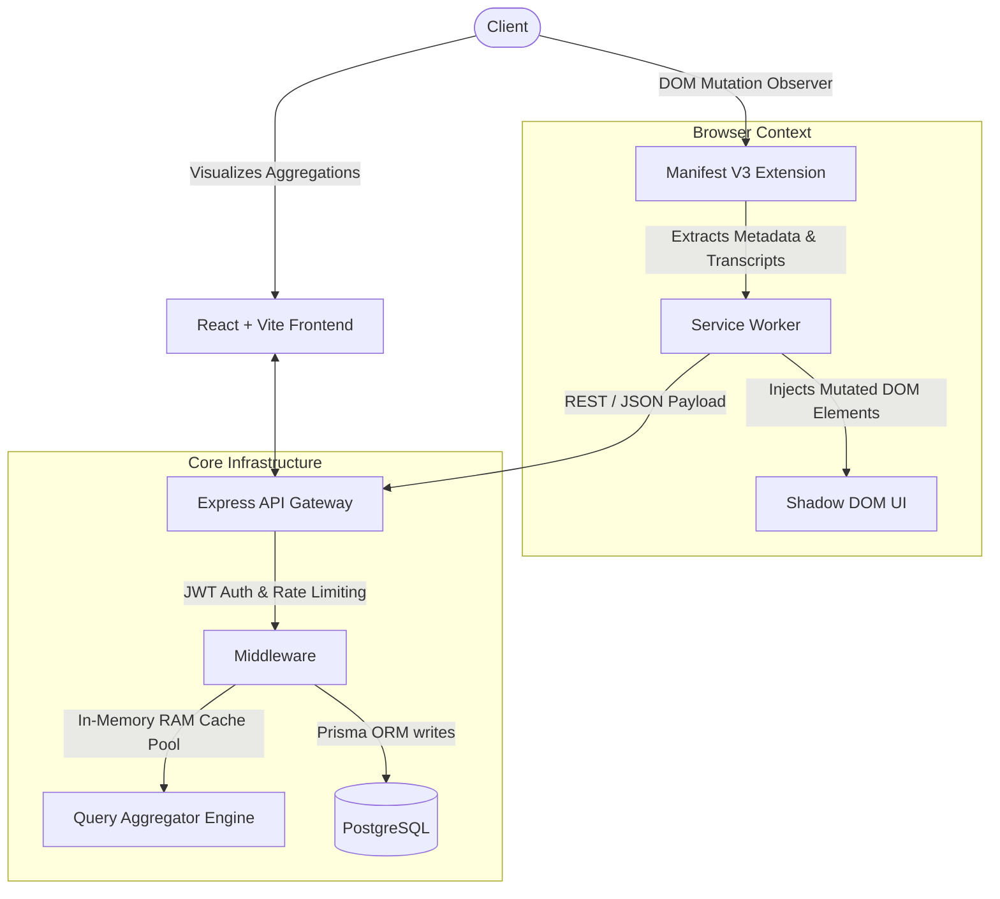
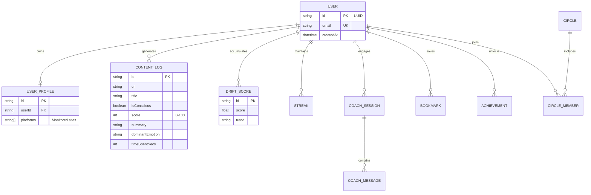

# Cognify

**Agentic Content Intelligence & Semantic Alignment Architecture**

Cognify is a sophisticated, AI-driven content intelligence platform engineered to counteract engagement-optimized algorithms. Designed as an autonomous Agentic RAG (Retrieval-Augmented Generation) system, Cognify operates as a man-in-the-middle for content consumption, actively parsing, semantically embedding, and scoring digital content streams against predefined ontological user goals.

---

## 🏗 System Architecture & Workflows

Cognify utilizes a distributed microservice architecture comprising an edge-injected Chrome extension, a high-concurrency Node.js/Express API gateway, and a highly optimized relational persistence layer via PostgreSQL.

### Data Flow & Inference Pipeline



---

## 🗄️ Entity-Relationship Model (ERD)

The persistent data storage is handled by PostgreSQL via Prisma ORM, utilizing Foreign Keys, Cascading deletes, and highly optimized indexing for millisecond response times.



---

## 🛠 Tech Stack

- **Backend Infrastructure**: Node.js, Express, Prisma ORM, PostgreSQL.
- **Frontend Dashboard**: React 18, Vite, Tailwind CSS (Strict Monochrome Apple/Linear Theme), Framer Motion, Recharts.
- **Extension Integration**: Chrome Manifest V3 side-panel, content scripts, and background service workers.
- **Integrations**: Google Gemini API, YouTube Search APIs.

---

## 🚀 Local Development Setup

### Prerequisites
- Node.js 20+
- PostgreSQL (Local or Neon/Supabase)

### 1. Database & Express Backend
```bash
cd backend
npm install

# Configure your environment variables
cp .env.example .env 

# Push the schema to your Postgres instance
npx prisma db push
npx prisma generate

# Start the development server
npm run dev
```

### 2. React Frontend
```bash
cd frontend
npm install

# Start the Vite development server
npm run dev
```

### 3. Chrome Extension
1. Open Chrome and navigate to `chrome://extensions/`
2. Enable **Developer mode** in the top right.
3. Click **Load unpacked** and select the `/cognify-extension` directory in this repository.

---

## 🔒 Security & Performance
- **Payload Optimization**: The Express backend limits payloads intelligently (up to 50MB) to allow bulk extension syncing without triggering `413 Payload Too Large` errors.
- **Lightning Caching**: The recommendation engine uses smart RAM caching and single-threaded query aggregation to prevent CPU choking on lower-tier cloud environments (like Render Free Tier).
- **Type-Safety**: End-to-end type safety enforced via TypeScript and Prisma Client.
