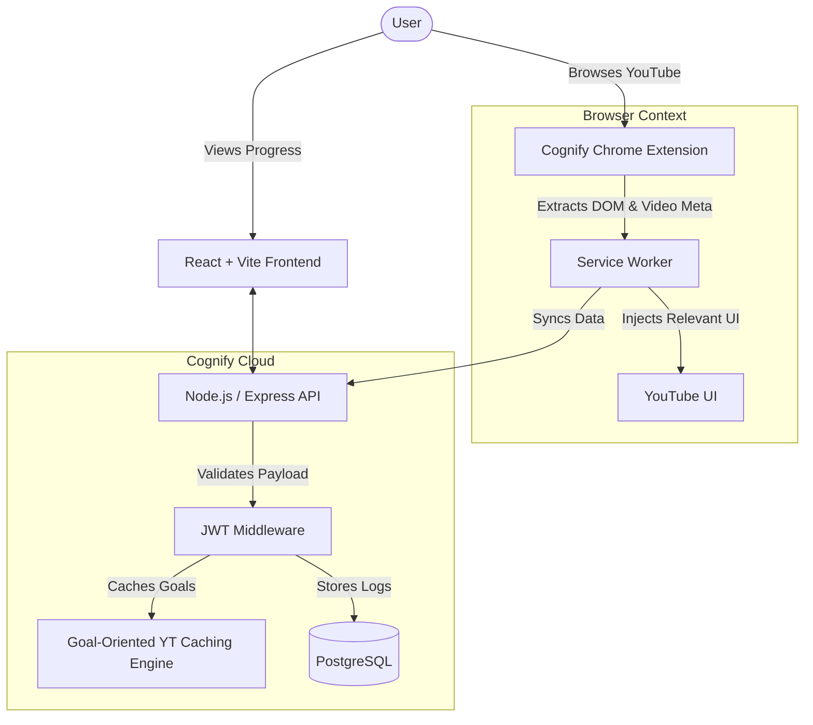
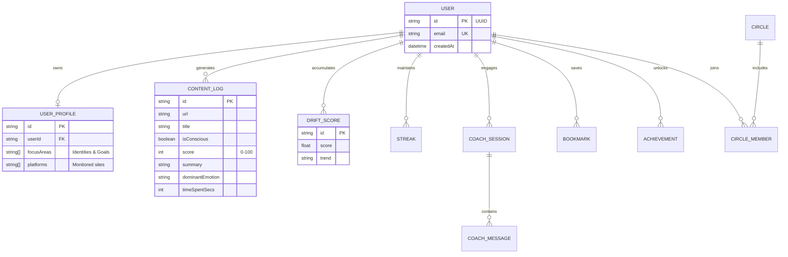

<div align="center">
  
  <h1>Cognify 🧠</h1>
  <p><strong>Agentic Content Intelligence & Digital Alignment Platform</strong></p>
  <p>
    
    
    
    
  </p>
</div>

<br/>

Cognify is an AI-powered, conscious content intelligence platform engineered to cure mindless scrolling. It operates as an **autonomous Agentic RAG system**, actively analyzing your digital diet (YouTube, Web) and providing real-time, personalized reality checks to align your content consumption with your stated life goals.

The system enforces a premium, minimalist monochrome aesthetic across the dashboard to reduce cognitive overload, eliminate gamification distractions, and enforce pure focus.

---

## ✨ Key Features

- **🛡️ Real-Time Distraction Blocking:** Seamless Chrome Extension that analyzes YouTube sidebars and DOM elements, intelligently replacing clickbait with hyper-relevant, goal-oriented content.
- **🧠 Autonomous Agentic RAG:** Leverages LLMs to grade your content consumption against your life goals (e.g., "UPSC Preparation"), generating a brutal, honest "Consciousness Score".
- **⚡ Lightning-Fast Content Engine:** Uses an optimized single-core caching architecture to instantly fetch, rank, and serve YouTube tutorials, masterclasses, and courses directly to your dashboard.
- **📈 Deep Analytics Dashboard:** Visualizes your "Digital Drift," focus streaks, reclaimed time, and emotional alignment across beautiful, Recharts-powered graphs.

---

## 🏗 System Architecture & Workflows

Cognify utilizes a sophisticated microservice architecture spanning a Chrome extension, a high-concurrency Node.js Express backend, and PostgreSQL for robust, relational persistence.

### Data Flow Diagram



---

## 🗄️ Entity-Relationship Model (ERD)

The persistent data storage is handled by PostgreSQL via Prisma ORM, utilizing Foreign Keys, Cascading deletes, and highly optimized indexing for millisecond response times.



---

## 🛠 Tech Stack

- **Backend Infrastructure**: Node.js, Express, Prisma ORM, PostgreSQL.
- **Frontend Dashboard**: React 18, Vite, Tailwind CSS (Strict Monochrome Apple/Linear Theme), Framer Motion, Recharts.
- **Extension Integration**: Chrome Manifest V3 side-panel, content scripts, and background service workers.
- **Integrations**: Google Gemini API, YouTube Search APIs.

---

## 🚀 Local Development Setup

### Prerequisites
- Node.js 20+
- PostgreSQL (Local or Neon/Supabase)

### 1. Database & Express Backend
```bash
cd backend
npm install

# Configure your environment variables
cp .env.example .env 

# Push the schema to your Postgres instance
npx prisma db push
npx prisma generate

# Start the development server
npm run dev
```

### 2. React Frontend
```bash
cd frontend
npm install

# Start the Vite development server
npm run dev
```

### 3. Chrome Extension
1. Open Chrome and navigate to `chrome://extensions/`
2. Enable **Developer mode** in the top right.
3. Click **Load unpacked** and select the `/cognify-extension` directory in this repository.

---

## 🔒 Security & Performance
- **Payload Optimization**: The Express backend limits payloads intelligently (up to 50MB) to allow bulk extension syncing without triggering `413 Payload Too Large` errors.
- **Lightning Caching**: The recommendation engine uses smart RAM caching and single-threaded query aggregation to prevent CPU choking on lower-tier cloud environments (like Render Free Tier).
- **Type-Safety**: End-to-end type safety enforced via TypeScript and Prisma Client.
