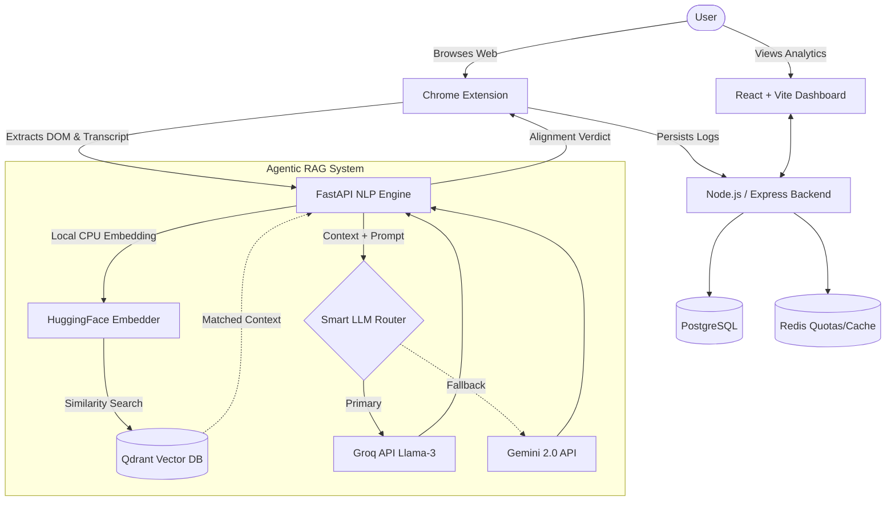
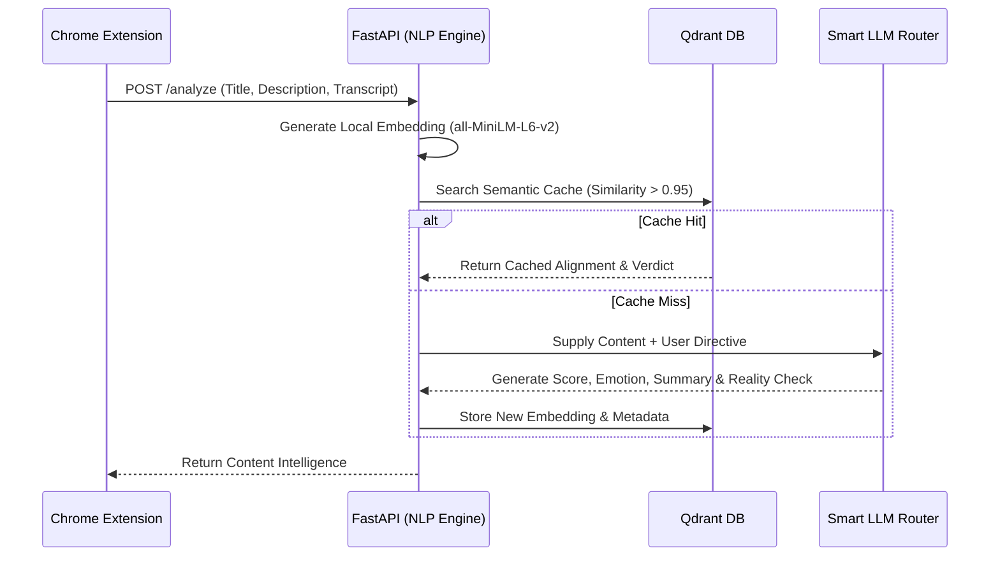
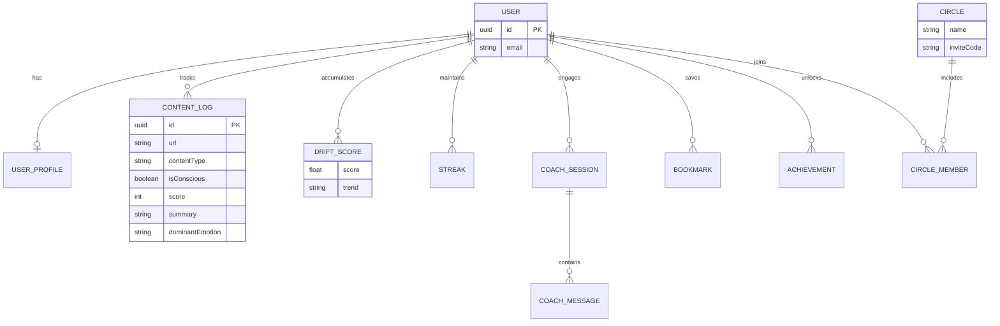

# Cognify 🧠: Agentic Content Intelligence

Cognify is an AI-powered, conscious content intelligence platform engineered to cure mindless scrolling. It operates as an **autonomous Agentic RAG system**, actively analyzing your digital diet (YouTube, Twitter) and providing real-time, personalized reality checks to align your content consumption with your stated life goals.

The system enforces a premium, minimalist "Apple/Linear" monochrome aesthetic across the dashboard to reduce cognitive overload and prevent gamification distractions.

---

## 🏗 System Architecture

Cognify utilizes a sophisticated microservice architecture spanning a Chrome extension, a high-concurrency Node.js backend, and an asynchronous Python FastAPI NLP engine.



---

## 🤖 Agentic RAG Workflow

The core of Cognify is the **Drift Coach**. Rather than blindly sending data to OpenAI, Cognify uses a locally-hosted semantic embedding model to cache requests, and a Smart LLM router to distribute prompt inference for zero-cost operation.



### Advanced AI Capabilities:
1. **Contextual Awareness**: The agent retrieves the user’s last 20 consumed items to establish a baseline of "Digital Drift."
2. **Harsh but Fair Coach**: Generates a "Drift Score" (0-100) alongside brutal, 1-sentence reality checks.
3. **Zero-Cost LLM Routing**: 
   - Primary: **Groq API** (Llama 3, lightning fast, free tier).
   - Fallback: **Gemini 2.0 Flash** API.
4. **Local Vector Embeddings**: Uses `sentence-transformers/all-MiniLM-L6-v2` inside the FastAPI runtime via `asyncio.to_thread` to prevent event loop blocking.

---

## 🗄️ Entity-Relationship Diagram

The persistent data storage is handled by PostgreSQL via Prisma ORM.



---

## 🛠 Tech Stack

- **AI & NLP Engine**: Python 3.11, FastAPI, HuggingFace (`sentence-transformers`), Qdrant Vector DB.
- **Backend Infrastructure**: Node.js, Express, Prisma ORM, PostgreSQL, Redis.
- **Frontend Dashboard**: React 18, Vite, Tailwind CSS (Strict Monochrome Apple/Linear Theme), Zustand.
- **Extension Integration**: Chrome Manifest V3 side-panel and content scripts.

---

## 🚀 Local Setup

### Prerequisites
- Node.js 20+
- Python 3.11+
- Qdrant (Docker)
- Redis

### 1. Python NLP Service (Core AI Engine)
```bash
cd cognify-nlp
python -m venv venv
source venv/bin/activate
pip install -r requirements.txt
uvicorn main:app --reload --port 8001
```

### 2. Database & Express Backend
```bash
cd backend
npm install
cp ../.env.example .env # Fill in DB credentials
npx prisma db push
npm run dev
```

### 3. React Frontend
```bash
cd frontend
npm install
npm run dev
```

## 🔒 Security & Performance
- **Zero-Paid APIs**: The entire NLP architecture is engineered to run free and fast using local models + free tier cloud GPUs.
- **Concurrency Control**: Async data pipelines (`asyncio.gather`) prevent starvation during peak load.
- **Input Validation**: Hardened endpoints using `pydantic` (Python) and `zod` (Node.js).
